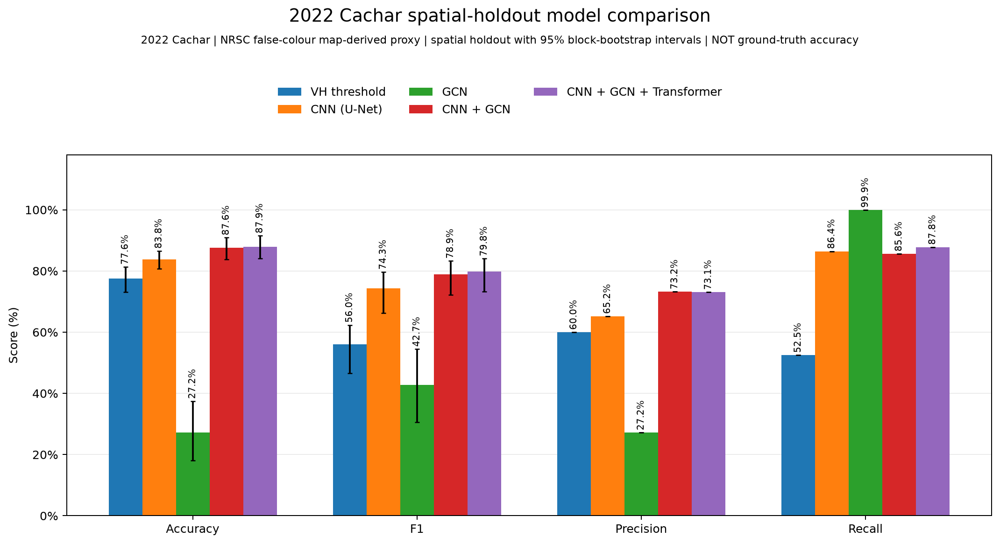
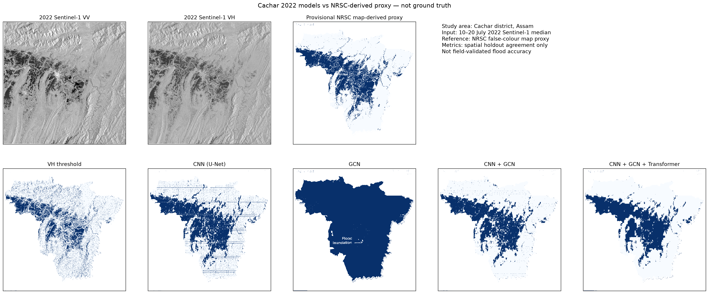
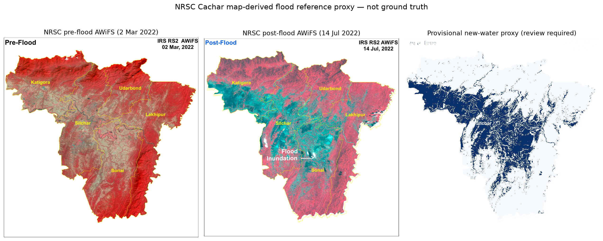

# Assam 2022 flood-event mapping

This repository contains a Cachar-only study of the July 2022 Assam floods.
It compares a Sentinel-1 VH threshold, a U-Net CNN, a GCN baseline, CNN+GCN,
and CNN+GCN+Transformer using spatially separate training, validation, and
test blocks.

## Study scope and limitations

- **Area and event:** the mapped Cachar study area during the July 2022 flood.
- **Input:** two-band Sentinel-1 VV/VH median composite from 10–20 July 2022.
- **Reference:** a provisional change proxy derived from the NRSC/ISRO Cachar
  map. It is not an official raster mask, field survey, or independent
  ground truth.
- **Interpretation:** all test metrics below measure agreement with this
  proxy, not validated flood accuracy. The post-flood AWiFS scene is dated
  14 July 2022, while the Sentinel-1 input is a 10–20 July median.

The holdout contains 38 geographically separate blocks (516 patches).
Thresholds are selected on validation blocks, not the test set. Bootstrap
intervals quantify spatial-block sampling variability; they do not account
for errors in the map-derived labels. This experiment does not establish
statewide or future-event performance.

## Clone and install (Windows PowerShell)

The GeoTIFFs use Git LFS. Install Git LFS before cloning so the data files
are downloaded instead of their small pointer files. The rasters require
several gigabytes of download and LFS storage.

```powershell
git lfs install
git clone https://github.com/Aman-Rana07/Disastermanagement-model.git
cd Disastermanagement-model
git lfs pull
py -3.13 -m venv .venv
.\.venv\Scripts\python.exe -m pip install --upgrade pip
.\.venv\Scripts\python.exe -m pip install -r requirements.txt
```

The Sentinel-1 input and the prepared reference proxy are included, so a
fresh clone can train without the original NRSC/ISRO PDF. The source PDFs are
not redistributed in this repository. To rebuild the proxy, obtain the
official Cachar flood map from NRSC/ISRO and save it as
`data/public_assam_2022/nrsc_reference/cachar_2022.pdf` before running the
reference-preparation script.

## Train and inspect results

Run from the repository root:

```powershell
.\.venv\Scripts\python.exe train_assam_2022.py
.\.venv\Scripts\python.exe show_assam_2022_results.py
```

Training fits all five methods and writes the report, model maps, comparison
chart, model checkpoints, and full-scene prediction rasters to
`data/exports/assam_2022/trained/`. The results command reads the saved
report, prints a score summary, regenerates the comparison chart, and opens
the comparison, model maps, and reference preview. It does not retrain.
For a headless run, add `--no-open`:

```powershell
.\.venv\Scripts\python.exe show_assam_2022_results.py --no-open
```

To create a new reference proxy from the official map before training, use:

```powershell
.\.venv\Scripts\python.exe prepare_nrsc_2022_reference.py
.\.venv\Scripts\python.exe train_assam_2022.py
.\.venv\Scripts\python.exe show_assam_2022_results.py
```

Review `data/exports/assam_2022/reference/nrsc_cachar_reference_review.png`
before interpreting scores. Map colors, river water, graphics, registration,
and different acquisition dates can introduce proxy-label errors.

## Saved figures

**Held-out comparison** — accuracy, F1, precision, and recall. Error bars
show 95% spatial-block bootstrap intervals.



**Model predictions and reference** — qualitative maps for the five methods.



**Reference review** — the provisional map-derived proxy and its review
image.



## Latest saved test results

The values below are agreement with the provisional Cachar proxy. F1
parentheses contain the 95% spatial-block bootstrap interval.

| Method | Accuracy | F1 (95% interval) | Precision | Recall |
|---|---:|---:|---:|---:|
| VH threshold | 77.6% | 56.0% (46.6–62.4%) | 60.0% | 52.5% |
| CNN (U-Net) | 83.8% | 74.3% (66.2–79.7%) | 65.2% | 86.4% |
| GCN | 27.2% | 42.7% (30.5–54.5%) | 27.2% | 99.9% |
| CNN + GCN | 87.6% | 78.9% (72.2–83.3%) | 73.2% | 85.6% |
| CNN + GCN + Transformer | **87.9%** | **79.8% (73.2–84.1%)** | 73.1% | 87.8% |

The GCN baseline predicts nearly all valid test pixels as positive and is
not a useful classifier in this run. The Transformer has the highest point
scores, but its F1 interval overlaps the CNN+GCN interval; this experiment
does not establish a definitive improvement. The complete report, including
Brier scores and confusion counts, is
[`assam_2022_spatial_holdout_metrics.json`](data/exports/assam_2022/trained/assam_2022_spatial_holdout_metrics.json).

Full-scene prediction rasters are also available:

- [VH threshold](data/exports/assam_2022/trained/predictions/vh_threshold_prediction.tif)
- [CNN](data/exports/assam_2022/trained/predictions/cnn_prediction.tif)
- [GCN](data/exports/assam_2022/trained/predictions/gcn_prediction.tif)
- [CNN + GCN](data/exports/assam_2022/trained/predictions/cnn_gcn_prediction.tif)
- [CNN + GCN + Transformer](data/exports/assam_2022/trained/predictions/cnn_gcn_transformer_prediction.tif)

## Reproducibility

Run the tests with:

```powershell
.\.venv\Scripts\python.exe -m unittest discover -s tests -v
```

When sharing changes, keep Git LFS installed and check that the GitHub
repository has enough LFS storage and bandwidth for its raster files.
